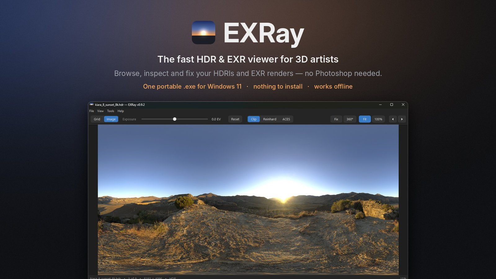
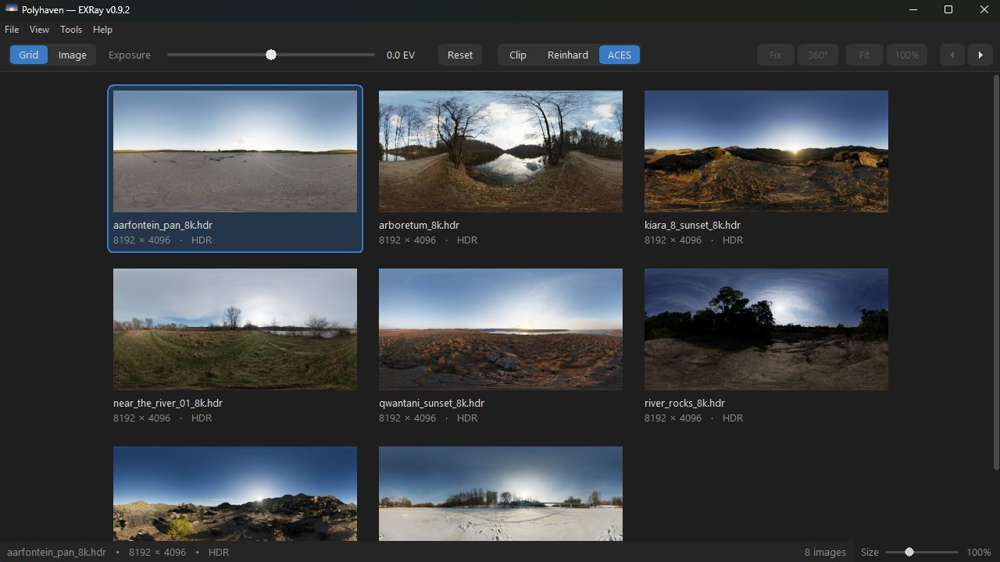
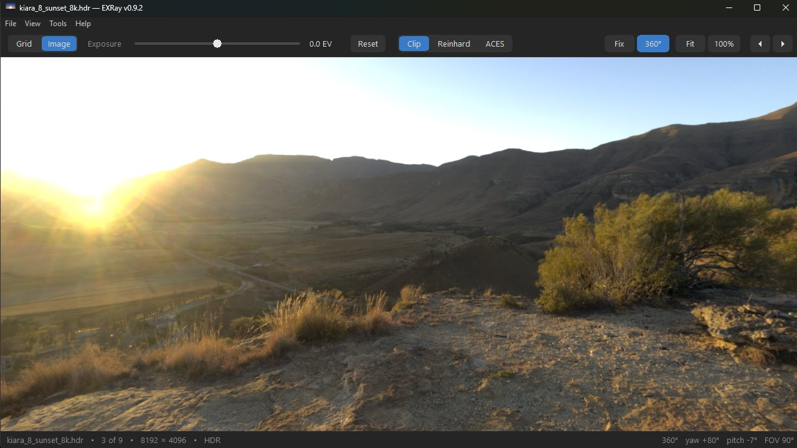
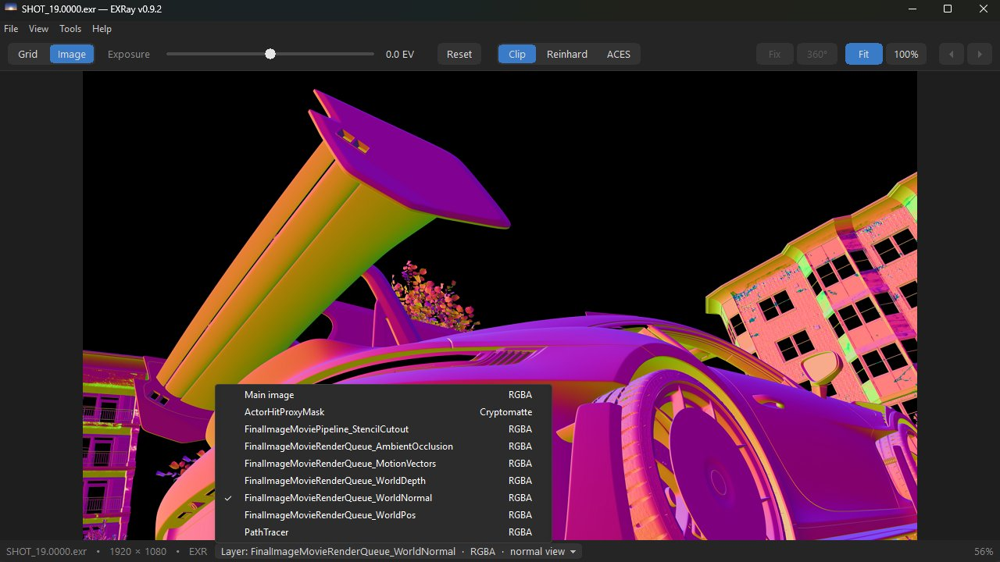
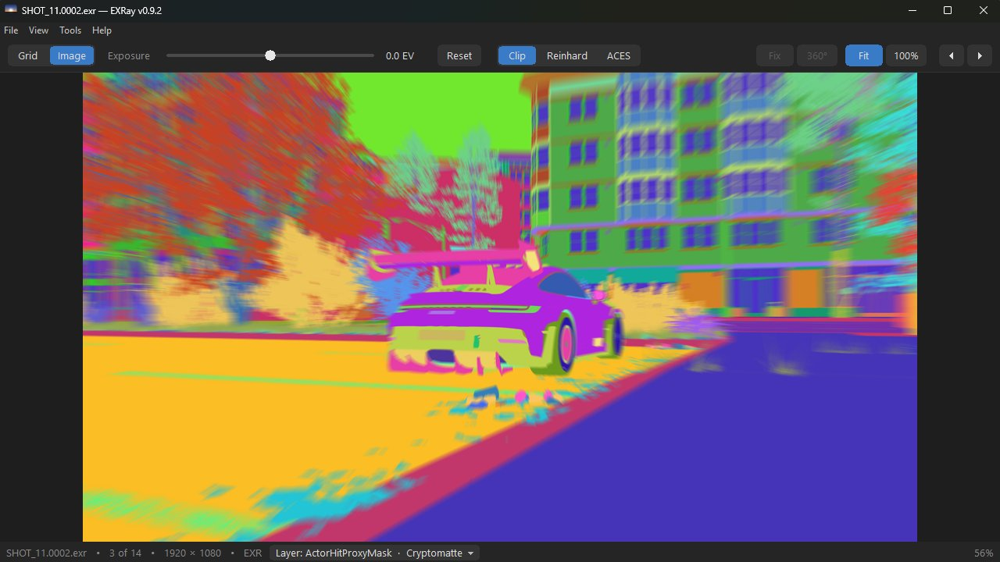
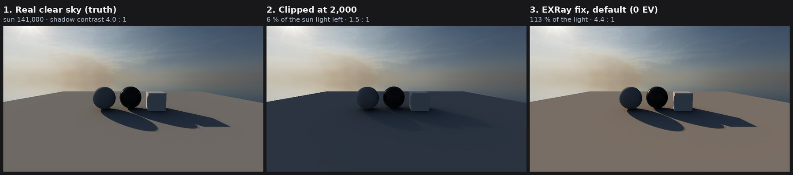
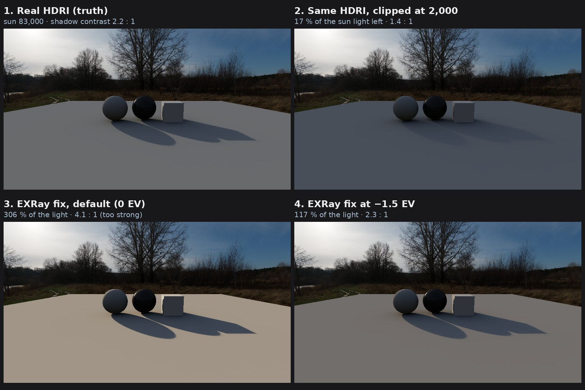

<p align="center"></p>

# EXRay

**A fast, free viewer for HDRIs and EXR renders on Windows 11.** Browse a whole
folder of `.hdr` and `.exr` files as thumbnails, look inside multi-layer
renders, check and fix HDRIs before they light your scene — without opening
Photoshop. One small portable `.exe`, nothing to install, works fully offline.

**[⬇ Download the latest release](https://github.com/p1xelrise/EXRay/releases/latest)** ·
[Download page](https://p1xelrise.gumroad.com/l/exray) ·
[Sponsor](https://github.com/sponsors/p1xelrise) ·
[Version history](release/VERSION-HISTORY.md) ·
[Report a bug](https://github.com/p1xelrise/EXRay/issues)

> EXRay is in **beta**. It works well, but has been tested on only a few PCs so far.

## What it does

- **Your folders in one place:** add HDRI and EXR folders from any drive, browse them as a tree, and search file names across all of them (Ctrl+F). EXRay remembers them and notices new files.
- **Thumbnail grid** of a whole folder, made in the background. Handles 16K HDRIs and files over 2 GB.
- **Inspector:** size, brightest value and range of the selected image, with quick actions.
- **Image view** with exposure (−10 … +10 EV), Clip / Reinhard / ACES tonemaps, zoom, pan and arrow-key browsing.
- **360° view** of equirectangular HDRIs: drag to look around, wheel for field of view.
- **EXR layers**: multi-layer, multi-part and multi-view files; readable depth, normal and motion-vector views; the real stored values under the mouse.
- **Cryptomatte**: ID colours, object and material names under the mouse, click to isolate a mask.
- **Export** one image or a whole selection as PNG or JPEG, optionally every layer.
- **Fix HDRI**: finds a clipped sun, broken pixels (NaN, infinite, negative) and hot pixels, and fixes them. Saves a clean copy as EXR (32-bit or half) or HDR. Sun check (S) shows at a glance whether a sun is clipped.

| | |
|---|---|
|  |  |
|  |  |

## Fix HDRI, tested on real HDRIs

A clipped sun keeps only a small part of its real light, so shadows go soft and
highlights dull. EXRay rebuilds the sun from the sky around it. To check that
this gives the *right* light, HDRIs with real, unclipped suns were clipped on
purpose, fixed by EXRay and compared with the originals
([tests/ground_truth_test.cpp](tests/ground_truth_test.cpp)): with the sky set
to match the photo (Clear, Light haze or Hazy), the rebuilt sun gave
**75–122 % of the real light** in every case.



A clipped file no longer records how hazy the sky was, so the sky choice is
yours. With a hazy sky the Clear setting gives 2–3× too much light:



## Get it

1. Download the zip from [Releases](https://github.com/p1xelrise/EXRay/releases/latest) and unzip it anywhere.
2. Run `EXRay_v….exe`. Drop an `.hdr` or `.exr` file or a whole folder onto the window. F1 lists every shortcut.

The first time, Windows may show "Windows protected your PC": EXRay comes from
an independent developer and isn't code-signed yet. Click **More info → Run anyway**.
Each release lists the SHA-256 of the zip and the `.exe`, so you can check your download.

Requirements: Windows 11, 64-bit.

## Support EXRay

EXRay is free, with every feature, for personal use and paid client work. If it
saves you time, you can support it through
[GitHub Sponsors](https://github.com/sponsors/p1xelrise) or with a payment of your
choice on the [download page](https://p1xelrise.gumroad.com/l/exray). It's
optional and changes nothing in the app. Starring the repository and telling other artists
about it helps too.

## Build it yourself

EXRay is C++17 with the plain Windows API (Win32 + GDI) — no frameworks, one
statically linked `.exe`. It is cross-compiled from Linux with
[llvm-mingw](https://github.com/mstorsjo/llvm-mingw):

```sh
LLVM_MINGW=/path/to/llvm-mingw ./build.sh          # -> build/x86_64/EXRay_v<version>.exe
tests/build_tests.sh                               # native test tools -> build/linux/
build/linux/fix_test                               # e.g. the Fix HDRI test
```

More about the code layout, the tests and the tools: [docs/DEVELOPMENT.md](docs/DEVELOPMENT.md).

## Contributing

Bug reports, ideas and pull requests are welcome — please open an
[issue](https://github.com/p1xelrise/EXRay/issues) first for anything big.
For a bug, the EXRay version, what you did and (if you can share it) the file help a lot.
EXRay is made in spare time, so replies may take a little while.

## License

EXRay is free software under the **GNU General Public License v3.0 or later**
([LICENSE](LICENSE)). You may use, study, change and share it; shared changed
versions must stay under the same license, with their source code.

The license covers the code, not the name **“EXRay”**, the EXRay logo or the
pixelrise logo — modified versions must use their own name and logo. See
[TRADEMARKS.md](TRADEMARKS.md).

EXRay includes [tinyexr](https://github.com/syoyo/tinyexr) (BSD 3-Clause),
[miniz](https://github.com/richgel999/miniz) (MIT) and
[stb_image / stb_image_write](https://github.com/nothings/stb) (MIT or public
domain) — see [THIRD-PARTY-NOTICES](release/THIRD-PARTY-NOTICES.txt).

---

Made with ❤ from Greece by **pixelrise** (Giorgos Eleftheroglou) · pixelrise@gmail.com
